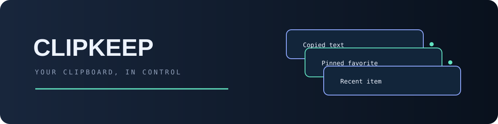

<div align="center">

<p align="center"></p>



<br/>


-4a90ff?style=for-the-badge&logo=linux&logoColor=white)


</div>

## Table of Contents

- [Overview](#overview)
- [Features](#features)
- [Technical Architecture](#technical-architecture)
- [Installation](#installation)
  - [Debian/Ubuntu (.deb package)](#debianubuntu-deb-package)
  - [AppImage (Standalone)](#appimage-standalone)
  - [Manual Installation](#manual-installation)
  - [Building from Source](#building-from-source)
  - [Building Packages](#building-packages)
- [Usage](#usage)
  - [Basic Operations](#basic-operations)
  - [Keyboard Shortcuts](#keyboard-shortcuts)
  - [Context Menu](#context-menu)
- [Configuration](#configuration)
  - [Hotkey](#hotkey)
  - [Startup](#startup)
- [System Requirements](#system-requirements)
- [Contributing](#contributing)
- [License](#license)
- [Acknowledgements](#acknowledgements)
- [Release Notes](#release-notes)
- [Support](#support)

## Overview

Clipkeep is a lightweight Linux clipboard manager with a modern dark UI, featuring clipboard history (Recent), persistent Favorites, system tray integration, global hotkey (Insert), and a clean interface with preview functionality.

<div align="center">


</div>

### Project Details

**Version:** v0.1.0

**Architecture:**
- **Frontend:** PyQt5 with custom QWidgets
- **Backend:** Python 3.9+ with PyQt5 and python-xlib
- **Database:** SQLite for favorites persistence
- **Hotkey System:** X11 query_keymap() polling (desktop environment compatible)

**Design Philosophy:**
- Minimalist, professional dark theme
- Cross-platform Linux compatibility
- Focus on essential clipboard management features
- Lightweight resource usage

## Features

| | Feature | Description |
|---|---|---|
|  | **Clipboard History** | View and paste recent clipboard items (text, images, URLs) |
|  | **Favorites** | Pin frequently used items for quick access |
|  | **Modern Dark UI** | Clean, minimalist interface with preview panels |
|  | **System Tray Integration** | Minimize to tray and access via the icon menu |
| ️ | **Global Hotkey** | Use the `Insert` key to quickly show/hide Clipkeep |
|  | **Linux Ready** | Works on Linux distributions with X11 |
|  | **Lightweight** | Minimal resource usage, focused on essential features |

## Technical Architecture

### Core Components

**UI Framework:** PyQt5
- Custom widgets for modern dark theme
- Smooth animations and transitions
- Responsive design with 420px fixed width
- Preview panel system (separate floating window)

**Hotkey Backend:** python-xlib
- X11 `query_keymap()` polling approach
- Avoids desktop environment conflicts
- 100ms polling interval for responsiveness
- Global hotkey support (Insert key by default)

**Data Storage:** SQLite
- Persistent favorites database
- Efficient clipboard history management
- Automatic cleanup and backup

**Build System:**
- **PyInstaller:** Creates standalone AppImage executable
- **linuxdeploy:** Packages AppImage with system dependencies
- **Debian packaging:** Creates .deb package with systemd integration

### Design Decisions

1. **PyQt5 Migration:** Originally PySide6, switched to PyQt5 due to CPU limitations (lack of SSE4.2+popcnt instructions)
2. **Hotkey Implementation:** Uses polling instead of `x11grab` to avoid conflicts with desktop environments like GNOME, KDE, etc.
3. **Clipboard Monitoring:** 500ms polling timer for clipboard changes
4. **Dark Theme:** Pure black/dark gray palette with gold accents for favorites

## Installation

### Debian/Ubuntu (.deb package)

```bash
apt update
apt install clipkeep
```

### AppImage (Standalone)

Download the latest AppImage from releases and make it executable:

```bash
chmod +x Clipkeep.AppImage
./Clipkeep.AppImage
```

### Manual Installation

1. Download the latest release
2. Extract the contents
3. Run `clipkeep` from the extracted directory

### Building from Source

1. **Clone the repository**:
   ```bash
   git clone https://github.com/ERROR404DTIR/clipkeep.git
   cd clipkeep
   ```

2. **Install dependencies**:
   ```bash
   python3 -m venv .venv
   source .venv/bin/activate
   pip install -r requirements.txt
   ```

3. **Run the application directly from source**:
   ```bash
   cd src
   python3 -m clipkeep.main
   ```

4. **Or install as a package**:
   ```bash
   pip install -e .
   clipkeep
   ```

### Building Packages

For users who want to build the DEB package or AppImage manually from the source repository:

```bash
# Build AppImage (standalone)
./build-appimage.sh

# Build DEB package (Debian/Ubuntu)
./build-deb.sh
```

The built packages will be available in the `dist/` directory.

## Usage

### Basic Operations

- **Paste items**: Click on any clipboard item to paste it
- **Preview items**: Right-click on items to see preview (images show larger view)
- **Toggle favorites**: Left-click the star icon next to any item
- **Search**: Use the search bar to filter items by content
- **Tabs**: Switch between "Recent" and "Favorites" sections

### Keyboard Shortcuts

| Key | Action |
|---|---|
| `Insert` | Show/hide clipboard manager |
| `Esc` | Close popup/preview |
| `Delete` | Remove current item |
| `↑` `↓` | Navigate items |

### Context Menu

Right-click on items for additional options:
- Copy to clipboard
- Delete item
- View preview

## Configuration

### Hotkey

The default hotkey is `Insert`. You can modify the hotkey behavior in the `hotkeys.py` file.

### Startup

- **DEB package**: Automatically starts with systemd --user
- **AppImage**: Can be started manually or added to startup applications

## System Requirements

- Linux distribution with X11
- Python 3.9 or higher
- PyQt5
- python-xlib (for hotkey support)
- X11 libraries

## Contributing

### How to Contribute

1. **Fork the repository**
2. **Create a feature branch**
3. **Implement changes**
4. **Run tests**
5. **Submit a pull request**

### Development Setup

```bash
# Clone the repository
git clone https://github.com/ERROR404DTIR/clipkeep.git
cd clipkeep

# Create virtual environment and install dependencies
python3 -m venv .venv
source .venv/bin/activate
pip install -r requirements.txt

# Run tests
pytest
```

### Testing

The project uses pytest for testing. Ensure all tests pass before submitting changes:

```bash
pytest -v
pytest --cov=src
```

### Code Standards

- Python 3.9+ syntax
- Type hints throughout
- PyQt5 only dependencies
- Custom widget architecture preserved
- All existing signals and slots maintained

### What NOT to Do

- DO NOT modify `src/clipkeep/popup.py` (handled by separate UI redesign)
- DO NOT change popup width (fixed at 420px)
- DO NOT add/remove tabs
- DO NOT change signal names
- DO NOT break existing method signatures
- DO NOT add new dependencies
- DO NOT modify other core files (`clipboard.py`, `favorites.py`, etc.)
- DO NOT add timestamps back
- DO NOT make preview inline (must remain separate window)
- DO NOT change preview position (must remain LEFT side)

### UI Redesign Note

For UI redesign specifications, refer to `claude-ui.md` in the main project directory. This document outlines the complete modern dark theme redesign while maintaining all existing functionality.

## License

This project is licensed under the MIT License.

## Acknowledgements

- PyQt5: https://www.riverbankcomputing.com/software/pyqt/
- python-xlib: https://github.com/python-xlib/python-xlib
- Linux: https://www.kernel.org/

## Release Notes

See `releases/` for detailed release notes.

## Support

For support, please give the repo a 